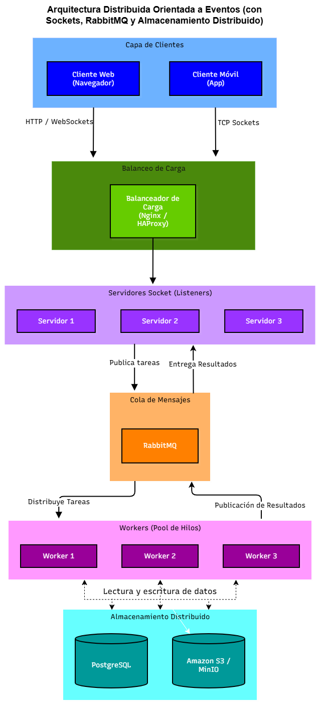

# Arquitectura Distribuida Orientada a Eventos basada en Sockets

Repositorio correspondiente al trabajo práctico de sistemas distribuidos de la materia **Programación Sobre Redes** de la **Tecnicatura en Desarrollo de Software** del **IFTS N° 29** (Año 2026). 

El proyecto (`pfo3-sistema-distribuido-sockets`) implementa una arquitectura orientada a servicios utilizando sockets en Python, simulación de workers concurrentes, balanceo de carga y componentes de almacenamiento distribuido.

---

## Descripción del Proyecto
El sistema simula el flujo de un entorno distribuido real:
1. Los **clientes** (web/móvil) envían tareas mediante peticiones de red.
2. El **balanceador de carga** (Nginx / HAProxy) distribuye el tráfico hacia los servidores disponibles.
3. Los **servidores de sockets** reciben las peticiones y las delegan mediante una **cola de mensajes** (RabbitMQ).
4. Un pool de **workers** procesa las tareas de forma concurrente utilizando hilos.
5. Los resultados y datos del sistema se persisten en un clúster de **PostgreSQL** y almacenamiento de objetos (**Amazon S3 / MinIO**).
---

## Diagrama de Arquitectura




## Tecnologías Utilizadas

**Python 3.x (compatible con Python 3.10, 3.11, 3.12, etc.):** Lenguaje base para la implementación de sockets y concurrencia.
- **Sockets TCP/IP & `concurrent.futures`:** Para la comunicación de red y el manejo del pool de hilos (`ThreadPoolExecutor`).
- **Nginx / HAProxy:** Balanceo de carga.
- **RabbitMQ:** Encolamiento y distribución de tareas asíncronas.
- **PostgreSQL & Amazon S3:** Almacenamiento relacional y de objetos.

---

## Guía de Ejecución Local

Sigue estos pasos para probar la interacción entre el servidor socket y el cliente en tu entorno local:

### 1. Clonar el repositorio
```bash
git clone https://github.com/<tu-usuario>/pfo3-sistema-distribuido-sockets.git
cd pfo3-sistema-distribuido-sockets
```

### 2. Iniciar el Servidor
Abre una terminal y ejecuta el servidor de sockets (escuchará en `127.0.0.1:65432` con un pool de 4 workers):
```bash
python servidor.py
```

### 3. Ejecutar el Cliente
Abre una **segunda terminal** y ejecuta el cliente para enviar una tarea de prueba:
```bash
python cliente.py
```

---

## Estructura del Repositorio

```text
.
├── servidor.py                # Servidor de sockets con pool de hilos para tareas concurrentes
├── cliente.py                 # Cliente socket emisor de tareas en formato JSON
├── Cliente-Servidor.drawio.png # Diagrama de arquitectura del sistema
└── README.md                  # Documentación principal del proyecto
```